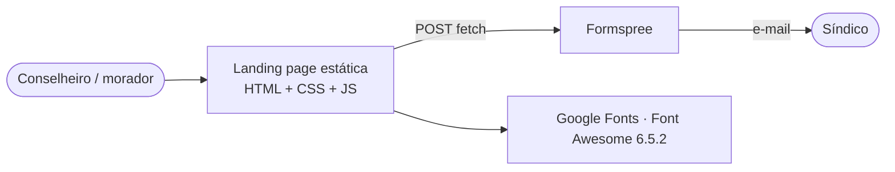

# Arquitetura — FacilAdmin (landing page)

## 1. Visão C4



| Contêiner | Tecnologia | Hospedagem gratuita |
|---|---|---|
| Página | HTML5, CSS3, JavaScript sem framework | GitHub Pages, Netlify ou Vercel |
| Formulário | Formspree (plano gratuito: 50 envios/mês) | SaaS |

## 2. Estrutura

```
index.html          conteúdo e marcação acessível
style.css           design system (tokens em :root) + bloco "ciclo MVP" no fim
script.js           menu, rolagem, carrossel, formulário
profile/*.webp      (novo) imagens otimizadas usadas na página
public/             favicons e manifesto
docs/               análise, arquitetura e plano
```

## 3. Jornada e funil

| Etapa | Seção | Objetivo |
|---|---|---|
| Atenção | Hero + carrossel | Mostrar o "rigor de engenharia" em 5 s |
| Problema | Problema × solução | Espelhar a dor do conselho |
| Oferta | Ecossistema de serviços | Três pilares (financeiro, engenharia, jurídico) |
| Autoridade | Diferencial + especialista | Humanizar e diferenciar |
| Prova | Depoimentos | Reduzir risco percebido |
| Ação | Formulário | Diagnóstico gratuito |

## 4. Decisões (ADR)

### ADR-001 — WebP de 900 px no lugar dos PNG de 1024 px

- **Decisão:** gerar `.webp` (qualidade 78) das 11 imagens usadas e manter os PNG só até você apagá-los.
- **Consequência:** ~19 MB → ~620 KB (−97%). Suporte a WebP é universal nos navegadores atuais.

### ADR-002 — Carrossel acessível sem biblioteca

- **Decisão:** padrão WAI-ARIA *Carousel* (`aria-roledescription`, slides ocultos com `aria-hidden`, rótulo ao vivo), pausa por botão, ao passar o mouse e ao focar; sem troca automática com `prefers-reduced-motion`.
- **Consequência:** atende WCAG 2.2.2 sem dependências.

### ADR-003 — Formspree mantido, com honeypot e validação por campo

- **Decisão:** manter o Formspree (sem back-end próprio) e usar o campo `_gotcha`.
- **Consequência:** spam simples é descartado pelo próprio Formspree; erros aparecem junto ao campo.

### ADR-004 — Conteúdo sensível não foi alterado

- **Decisão:** os depoimentos e o "98%" continuam como estavam; o "[X]+" foi comentado no HTML.
- **Consequência:** a decisão de manter, trocar por depoimentos reais autorizados ou remover é sua (ver pendências).

## 5. Fora do escopo

- Páginas legais (política de privacidade completa), Google Analytics/Consent Mode, blog.
- Links reais das redes sociais (dependem de você).
